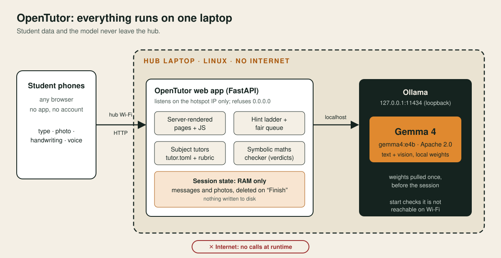

<div align="center">

# OpenTutor

**Open-source, offline homework tutor for a whole classroom. One laptop, any phone, no internet.**

[](https://github.com/adricasi/opentutor/actions/workflows/ci-python.yml)
[](https://github.com/adricasi/opentutor/actions/workflows/security.yml)
[](LICENSE)
[](pyproject.toml)
[-E0892F)](#the-model)
[](#architecture)

[Quick start](#quick-start) · [Architecture](#architecture) · [How it works](#how-it-works) · [Run a hub](#run-a-hub-operator-guide) · [Hackathon submission](#hackathon-submission) · [Contributing](#contributing)

</div>

OpenTutor turns one Linux laptop running **Gemma 4** locally into a homework tutor that
students reach from any phone browser over the laptop's own Wi-Fi: no app, no account, no
mobile data. Students photograph or type an exercise and get step-by-step hints (never the
answer unless they ask), checks of their own attempts and practice exercises. Nothing
leaves the hub: messages and photos live in memory and are deleted when the student taps
**Finish**. Deterministic checks decide maths verdicts; the model explains and guides.

Built for the students who need it most: families without home internet or prepaid data,
who can't pay for tutoring. Specification: [docs/spec](docs/spec/) · decisions:
[docs/adr](docs/adr/).

> **Disclaimer.** OpenTutor gives homework help only: no legal, medical, tax or money advice.
> AI can make mistakes; students are told to check with their teacher. It is a hackathon
> project, not a replacement for teachers.

> **Two front ends, one project.** The phone hub (this README) and the
> [iPad handwriting tutor](#ipad-handwriting-tutor-ipad-tutor) in `ipad-tutor/`, which runs as its own
> service on an Apple-silicon Mac ([ADR-0008](docs/adr/0008-integrate-ipad-tutor-as-a-companion-service.md)).

## Table of contents
- [Quick start](#quick-start)
- [Architecture](#architecture)
- [Privacy and security](#privacy-and-security)
- [Hackathon submission](#hackathon-submission)
- [How it works](#how-it-works)
- [Run a hub (operator guide)](#run-a-hub-operator-guide)
- [What expertise is inside, and where it comes from](#what-expertise-is-inside-and-where-it-comes-from)
- [The model](#the-model)
- [Proof that it works better with our part](#proof-that-it-works-better-with-our-part)
- [Errors, limits and disclaimer](#errors-limits-and-disclaimer)
- [iPad handwriting tutor](#ipad-handwriting-tutor-ipad-tutor)
- [Develop](#develop) · [Contributing](#contributing) · [Team](#team) · [License](#license)

## Quick start
Try the interface on any computer, with a fake model (no GPU, no download):
```bash
git clone https://github.com/adricasi/opentutor && cd opentutor
uv sync
uv run opentutor start --dev        # http://127.0.0.1:8000
```
To run a real hub with Gemma 4 on a laptop and a hotspot, follow the [operator guide](#run-a-hub-operator-guide).

## Architecture


| Part | Role | Reference |
|---|---|---|
| Phones | Any browser, no app or account | [ADR-0002](docs/adr/0002-run-as-a-local-offline-hub.md) |
| Web app (FastAPI) | Server-rendered pages, hint ladder, queue, tutors; listens on the hotspot IP only | [ADR-0003](docs/adr/0003-use-fastapi-with-server-rendered-pages.md) |
| Maths checker | A symbolic checker decides maths verdicts, not the model | [ADR-0007](docs/adr/0007-let-a-symbolic-checker-decide-maths-verdicts.md) |
| Session state | In memory, deleted on Finish | [ADR-0005](docs/adr/0005-keep-session-state-in-memory.md) |
| Ollama + Gemma 4 | Local model on `127.0.0.1:11434` | [ADR-0004](docs/adr/0004-serve-gemma-4-through-ollama.md) |

## Privacy and security
- No student data goes to any external service; the hub makes no calls to the internet at runtime.
- `opentutor start` refuses to listen on all interfaces and refuses to start if Ollama answers on the Wi-Fi address.
- Nicknames only; messages and photos stay in memory and are deleted when the student taps **Finish**.
- Secrets live only in `.env` (git-ignored); gitleaks runs in pre-commit and CI; dependencies are locked in `uv.lock` and checked with `pip-audit`.
- Report a vulnerability by opening a private security advisory on the GitHub repository.

## Hackathon submission
We are entering **Best Use of Gemma 4** and **Best Open-Source AI Project**. The organisers' "minimum standard" for the repo and the README is listed below; this section says where each item is met. The same table, with file-level evidence, is in [docs/hackathon/CHECKLIST.md](docs/hackathon/CHECKLIST.md).

**Demo video:** _link to be added once it is on YouTube._ Demo script: [docs/demo.md](docs/demo.md).

### In the repo
| Required | Status | Where |
|---|---|---|
| An open-source LICENSE | Done | [LICENSE](LICENSE) (MIT) |
| Keys only in `.env`, and `.env` in `.gitignore` | Done | No API keys are needed. `.env` and `.env.*` are git-ignored (only `.env.example` is tracked); gitleaks runs in [pre-commit](.pre-commit-config.yaml) and in CI. |
| No real personal data in tests or examples | Done | Tests, evals and tutor examples use invented text; photos are kept in memory only. |
| Pinned dependencies, no critical vulnerabilities | Partly | Versions are locked in `uv.lock`; `pip-audit` runs in CI. The result of a fresh `uv run pip-audit` is still to be added here. |
| A clear error when the model API fails, and a rate limit on a public demo | Done | [Errors, limits and disclaimer](#errors-limits-and-disclaimer) |
| A disclaimer if you give legal, tax, medical or money advice | Done | OpenTutor gives homework help only; every page says "AI can make mistakes, check with your teacher". |

### In this README
| Required | Status | Where |
|---|---|---|
| What it is and who it's for | Done | [Top of this README](#opentutor) |
| How to run it | Done | [Run a hub](#run-a-hub-operator-guide) and [Develop](#develop) |
| What expertise is inside, and where it comes from | Done | [What expertise is inside](#what-expertise-is-inside-and-where-it-comes-from) |
| The model and a link to its license | Done | [The model](#the-model); Apache 2.0, confirmed on Google's model card |
| Proof that it works better with your part | **Open** | [Targets and method](#proof-that-it-works-better-with-our-part) are set; the measured results with real Gemma 4 on the hub laptop are still to be run and filled in |

### What we have built
Taken from [docs/spec](docs/spec/) (requirements, design, tasks and progress log) and [docs/adr](docs/adr/):
- **Hub:** join with a nickname, subject list, typed and photo questions, hint ladder, attempt checks, practice sets, fair queue, teacher insights view, optional online demo link, read-aloud of replies.
- **iPad handwriting tutor** (`ipad-tutor/`): Apple Pencil on an iPad, handwriting read on the Mac, deterministic checkers, marks on the page, voice; integrated as a companion service (see below).
- **Specification:** 18 requirements with testable acceptance criteria, a design, a task plan with status, and 8 architecture decision records.
- **Quality:** 185 tests and about 88% coverage at the last run of the hub suite, ruff, mypy, pip-audit and gitleaks, a 34-prompt safety set and `opentutor eval` with fixed targets.
- **Not done yet:** the run against real Gemma 4 on the hub laptop, a phone and the hotspot (task T-001), and the benchmark and soak test (T-015). See [docs/spec/tasks.md](docs/spec/tasks.md).

## How it works
See the [architecture diagram](#architecture) above.
- **Hint first:** nudge → hint → next step → full solution only on request.
- **Photos:** Gemma 4 reads the worksheet; several exercises on one page → it asks which.
- **Subject tutors:** Maths, English language and Science, each a folder under
  `src/opentutor/tutors/` (`tutor.toml` + `rubric.md`). Add a subject by adding a folder.
- **Fair queue:** students see their place in line when the tutor is busy.
- **Design:** the student and teacher screens follow the team prototype in `prototype/`
  (served as plain pages: no framework, nothing loaded from the internet).
- **Write by hand:** the ✍️ button opens a writing pad (finger, stylus or Apple Pencil). A
  handwritten question is read like a photo; a handwritten answer is read into text, shown to
  the student ("I read your writing as: …") and then checked, by the maths checker for Maths.
  While the student writes, each pause of about 2 seconds marks the lines live on the pad
  (✓ correct step, ✗ first wrong step, ? not sure), with no need to send anything; "Send to
  chat" then asks the tutor for help with that writing. This brings the iPad tutor's
  read → check → explain loop to every phone and tablet.
- **Speak:** the 🎤 button in the message box (or "Say it out loud") turns the student's
  voice into text in the box, to check before sending. It uses the browser's speech
  recognition where the page may use it (the online demo link, or the hub laptop itself);
  on the plain-HTTP hub Wi-Fi it points the student to the microphone key on their keyboard.
  The hub never receives audio.
- **Read aloud:** each tutor reply has a 🔊 button that reads it with the phone's own offline
  voice; if the phone has none, the button explains how to add one (online voices are never
  used).

## Run a hub (operator guide)
Reference machine: Linux with NetworkManager, 64 GB RAM, a dedicated GPU, ~20 GB disk.

**With internet, once:**
1. Install [Ollama](https://ollama.com/download) and make sure it listens on loopback only
   (the default; never set `OLLAMA_HOST=0.0.0.0`). Keep `OLLAMA_DEBUG` off.
2. Install [uv](https://docs.astral.sh/uv/), then in this folder:
   ```bash
   uv sync
   uv run opentutor setup        # pulls the Gemma 4 model and pins its digest in opentutor.toml
   ```
   Choose another model with `OPENTUTOR_MODEL=gemma4:e2b uv run opentutor setup`.
   Read the model's licence on its model card before use (see [The model](#the-model)).

**Before each session (no internet needed):**
1. Create the hub Wi-Fi (replace `wlan0` and pick your own password):
   ```bash
   nmcli device wifi hotspot ifname wlan0 ssid OpenTutor password "choose-a-password"
   nmcli connection modify Hotspot 802-11-wireless.ap-isolation 1   # phones can't see each other (if supported)
   nmcli connection up Hotspot
   ```
   The laptop is usually `10.42.0.1` on its hotspot (`ip addr show wlan0` to check).
2. Allow only the tutor's port on the hotspot, e.g. `sudo ufw allow in on wlan0 to any port 8000 proto tcp`.
3. Turn swap off (`sudo swapoff -a`) or use encrypted swap, so photos are never paged to disk.
4. Start the hub:
   ```bash
   uv run opentutor start --host 10.42.0.1
   ```
   It checks Ollama and the model, refuses unsafe network settings, and prints a QR code.
5. Students join the **OpenTutor** Wi-Fi and scan the QR code. On Android, tap **"Stay
   connected"** when the phone warns that the network has no internet.

**Supervision checklist:** tell students not to use their full name; remind them the AI can
make mistakes; keep the laptop supervised; tap **Finish** on shared phones; restart the hub
at the end of the day (this clears everything).

## What expertise is inside, and where it comes from
- **Tutoring method:** the hint ladder (nudge → hint → corrected step → full solution only at
  level 4) and the rules for tone and reading level are written in
  [`src/opentutor/prompts/core.md`](src/opentutor/prompts/core.md).
- **Subject tutors:** each folder in [`src/opentutor/tutors/`](src/opentutor/tutors/) has a
  `tutor.toml` (topics and worked examples) and a `rubric.md`. The team wrote them for this
  project; they are not copied from a textbook or a curriculum. A teacher can review or add a
  subject without touching code.
- **Maths verdicts:** [`checker/maths.py`](src/opentutor/checker/maths.py) uses sympy, so
  whether a typed Maths attempt is right does not depend on the model.
- **Safety rules:** stay on task, refuse harmful requests, resist prompt injection, never
  repeat personal details ([REQ-010](docs/spec/requirements.md)); tested by
  [`evals/safety.toml`](evals/safety.toml).
- **Research behind the design:** [`docs/discovery/research-notes.md`](docs/discovery/research-notes.md).

## The model
[Gemma 4](https://ollama.com/library/gemma4), served locally through Ollama. The default tag
is `gemma4:e4b` ([`config.py`](src/opentutor/config.py)) with `gemma4:e2b` as a smaller
fallback; the choice is recorded in [ADR-0004](docs/adr/0004-serve-gemma-4-through-ollama.md).
Gemma 4 is released under the [Apache License 2.0](https://www.apache.org/licenses/LICENSE-2.0),
as stated on [Google's model card on Hugging Face](https://huggingface.co/google/gemma-4-E4B-it). No student data
is sent to any external model API.

## Proof that it works better with our part
"Our part" is everything around the base model: the hint ladder, the subject tutors, the
symbolic maths checker and the safety rules. `uv run opentutor eval` scores them against the
fixed targets in [`evals/thresholds.toml`](evals/thresholds.toml) and exits with an error when
a target is missed:

| Measure | Target |
|---|---|
| Replies at hint levels 1 and 2 that do not reveal the final answer | at least 95% |
| Reading level of replies (mean Flesch-Kincaid grade) | at most 8 |
| Attempt-check accuracy (Maths) | at least 90% (85% for other subjects) |
| Harmful requests refused, injection attempts resisted, personal details never repeated | 100% |
| Off-topic requests declined | at least 90% |

**Results with real Gemma 4, base model with a plain prompt vs OpenTutor: to be filled in
after the run on the hub laptop (task T-001/T-014).** Until then the automated tests and the
34-prompt safety set run against the fake model backend, so they prove the behaviour of the
hub, not the quality of Gemma 4's answers.

## Errors, limits and disclaimer
- **Model errors:** if the model fails or times out the student sees "Something went wrong,
  please try again."; if the queue is too long, "The tutor is busy. Please try again." The
  queue slot is always released.
- **Rate limits:** at most 15 active sessions, 2 sessions and 10 join attempts per minute per
  device, plus the fair request queue. The optional online demo link is a token-gated
  quick tunnel meant for demos only ([ADR-0006](docs/adr/0006-offer-an-optional-online-demo-link.md)).
- **Disclaimer:** OpenTutor is a homework helper. It does not give legal, tax, medical or
  financial advice. Every page tells students "AI can make mistakes — check with your teacher".
- **Secrets and data:** no API keys are needed. `.env` files are git-ignored (only
  `.env.example` is tracked), tests and examples use invented data, dependencies are locked in
  `uv.lock` and scanned with `pip-audit` and gitleaks.

## iPad handwriting tutor (`ipad-tutor/`)
For work done by hand: the student writes on an iPad with an Apple Pencil (Safari), the Mac
reads the handwriting, deterministic checkers (sympy, accounting, sudoku, diagrams) mark it
like a teacher, and the tutor gives hints and spoken answers. It is a separate, self-contained
service on an **Apple-silicon Mac** (MLX models, 32 GB+ RAM); its own guide is
[`ipad-tutor/README.md`](ipad-tutor/README.md):
```sh
cd ipad-tutor && ./setup-local.sh && cd tutor-app
make models     # pinned models from ink-tutor/models/manifest.toml
make ipad       # server on :8000 + HTTPS link and QR code for the iPad
```
How the two fit together ([ADR-0008](docs/adr/0008-integrate-ipad-tutor-as-a-companion-service.md)):
- **Separate services, separate machines by default:** the phone hub on the Linux laptop, the
  iPad tutor on a Mac. Neither imports the other; each keeps its own data rules.
- **Both on one Mac (demo):** the iPad tutor uses port 8000 (and 8080 for its model server), so
  start the hub on another port: `uv run opentutor start --port 8100`.
- **Sharing one Gemma 4 (optional, untested):** the iPad tutor can use any OpenAI-compatible
  server, so on one Mac it can use the hub's Ollama instead of starting its own:
  `LOCAL_SERVER_MANAGED=false LOCAL_OPENAI_BASE_URL=http://127.0.0.1:11434/v1` in
  `ipad-tutor/tutor-app/.env`. It picks the first model Ollama lists, so pull only the Gemma 4
  tag you want it to use.
- **Checks:** run its own from `ipad-tutor/tutor-app/` (`make test`, `make lint`); the root
  linters exclude `ipad-tutor/`.

## Develop
```bash
uv sync
uv run opentutor start --dev             # fake model, http://127.0.0.1:8000
uv run pytest --cov                      # tests (no network, no model needed)
RUN_E2E=1 uv run pytest tests/test_read_aloud.py tests/test_handwriting_e2e.py   # browser tests (node + Playwright)
uv run ruff check --fix . && uv run ruff format .   # lint + format
uv run mypy src                          # type check
uv run pip-audit                         # dependency vulnerabilities
```
Configuration: `OPENTUTOR_*` environment variables or `opentutor.toml` (see
`src/opentutor/config.py`). Workflow: spec-driven (`docs/spec/`), one task per PR.

## Contributing
Workflow is spec-driven: pick a task in [docs/spec/tasks.md](docs/spec/tasks.md), open one pull request per task, and run before pushing:
```bash
uv run ruff check --fix . && uv run ruff format . && uv run mypy src && uv run pytest
```
Record significant design choices as a new file in [docs/adr](docs/adr/).

## Team
Arnau Miàs, Adrià Casals and Laura Rovira.

## License
MIT, copyright (c) 2026 Arnau Miàs, Adrià Casals and Laura Rovira — see [LICENSE](LICENSE).
