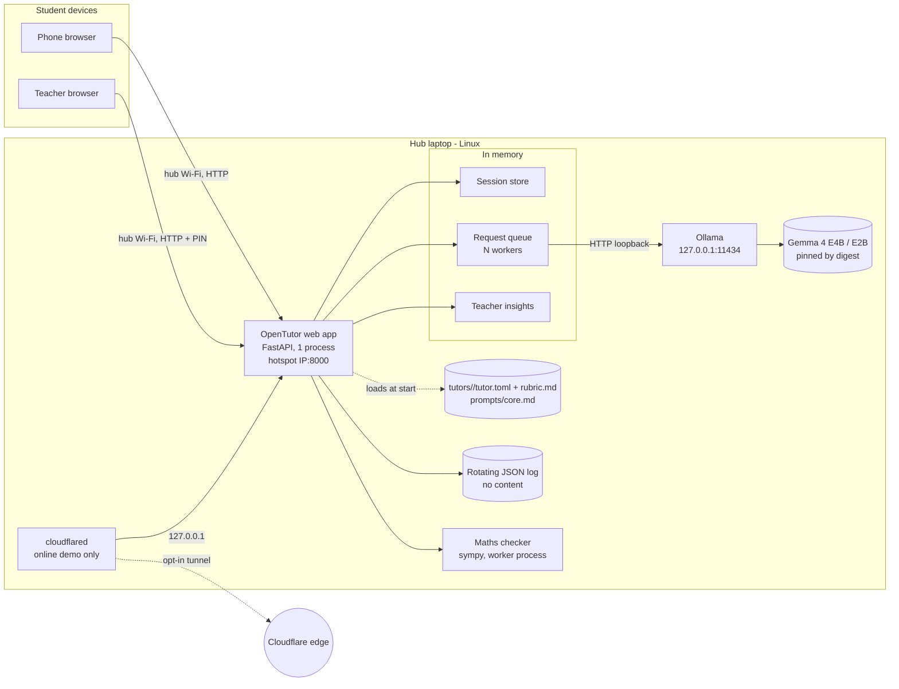

# Design: opentutor

- Status: In review <!-- Draft | In review | Approved -->
- Last updated: 2026-10-24
- Implements: requirements.md (REQ-*, NFR-*)

## Overview
- Deployment target: **Local / on-device** ([ADR-0002](../adr/0002-run-as-a-local-offline-hub.md)).

One Linux laptop (the hub) runs two processes: **Ollama** serving Gemma 4 on loopback,
and the **OpenTutor web app** (FastAPI, single process) on the hub's Wi-Fi interface.
Students' phones join the hub Wi-Fi (laptop hotspot), scan the QR code printed at start,
and use plain server-rendered pages. Each question goes through a fair in-memory queue to
the model; the reply streams back to the phone as it is generated. Everything is held in
memory and disappears at session end, after 30 minutes idle, or on restart. No call
leaves the hub during operation in **hub mode** (the default); internet is only used
once, during setup, to install dependencies, download the model and the pinned
`cloudflared` binary. An opt-in **online demo mode** (REQ-017, ADR-0006) adds a Cloudflare
quick tunnel for remote demos.

## Options considered
| Decision | Options | Chosen | ADR |
|---|---|---|---|
| Where it runs | Local hub · cloud backend · on-device per phone | Local hub | [0002](../adr/0002-run-as-a-local-offline-hub.md) |
| Web stack | FastAPI + server-rendered pages · Streamlit · Gradio · Open WebUI | FastAPI + Jinja2 + vanilla JS, NDJSON streaming | [0003](../adr/0003-use-fastapi-with-server-rendered-pages.md) |
| Model runtime | Ollama · llama.cpp server · vLLM | Ollama, Gemma 4 E4B default / E2B fallback, pinned by digest | [0004](../adr/0004-serve-gemma-4-through-ollama.md) |
| State | In memory · SQLite · Redis | In memory, single process | [0005](../adr/0005-keep-session-state-in-memory.md) |
| Remote demos | Tunnel as normal path · opt-in quick tunnel · named tunnel/ngrok · none | Opt-in, token-gated Cloudflare quick tunnel | [0006](../adr/0006-offer-an-optional-online-demo-link.md) |
| Maths verdicts | Model only · symbolic checker decides · checker as second opinion | sympy checker decides when it can read the attempt | [0007](../adr/0007-let-a-symbolic-checker-decide-maths-verdicts.md) |

## Components
| Component | Responsibility | Tech / local runtime | Requirements |
|---|---|---|---|
| Web app (HTTP layer) | Pages, JSON/NDJSON endpoints, cookies, input limits, rate limits, security headers | FastAPI on one `uvicorn.Server` (**1 worker**) serving pre-created sockets: hotspot IP:8000 and 127.0.0.1:8000, plus 127.0.0.1:8001 for the tunnel in online demo mode | REQ-001…REQ-007, REQ-011, NFR-001 |
| Pages and client script | Join, subject list, chat, teacher pages; camera/gallery input; client-side image downscale; streaming reader; quick actions; queue position; read aloud with on-device voices (D-10) | Jinja2 templates, one CSS file, one vanilla JS file; no framework, no CDN. Visual design ported from the team prototype (`prototype/`, `docs/prototype/claude-brief.md`): colours converted to hex, DM Sans bundled locally (OFL), lucide icons inlined (ISC) | REQ-001…REQ-007, REQ-009, REQ-018, NFR-003, NFR-005, NFR-010 |
| Session store | Create/resume/delete sessions, nickname uniqueness, 15-session cap, 30-min idle expiry sweep | Python dict + asyncio task, in memory | REQ-001, REQ-011, NFR-002, NFR-006 |
| Tutor registry | Load and validate `tutors/<id>/tutor.toml` + `rubric.md` at start; enabled list | `tomllib` (stdlib) + Pydantic models with `extra="forbid"` | REQ-002, REQ-008 |
| Prompt builder | Assemble the core rules + subject tutor + conversation into model messages; isolate untrusted content; apply the context budget | Versioned markdown files merged by `## section` (pattern from `ipad-tutor`'s `load_prompt`); core sections are locked; template function | REQ-005, REQ-010, AC-005.5 |
| Tutoring service | Turn intents (ask, hint, answer, check, practice) into model calls; hint level; exercise analysis; structured output validation with one retry | Python, Pydantic schemas → JSON schema for Ollama `format` | REQ-004…REQ-007, REQ-015 |
| Request queue | FIFO across all sessions; N parallel workers (N = Ollama parallel setting); positions; one in-flight request per session; 120-s queue timeout; 60-s model timeout | asyncio | REQ-009, AC-003.3, NFR-004 |
| Maths checker | Parse plain-text Maths attempts, check step equivalence and equation solutions, return verdict + first wrong step or "can't tell" | sympy (adapted from `ipad-tutor` `checkers/math.py`), allow-list tokenizer, worker process, 2-s limit | AC-006.6 … AC-006.9, ADR-0007 |
| Model client | Stream chat, structured calls, image input, health check, model/digest check | Official `ollama` Python client (async) over loopback HTTP [to confirm in T-001] | REQ-003…REQ-007, REQ-012 |
| Image pipeline | Reject bodies over 11 MB by `Content-Length` and a streaming byte cap before parsing; parse the upload in memory (multipart spooling raised above the cap, so nothing goes to a temp file); validate type/size, decode safely, fix EXIF orientation and drop metadata, downscale to the model's input size | Pillow, with pixel-count limit | REQ-004, NFR-001, NFR-002 |
| Teacher insights | Aggregate counters per tutor and topic (topics only from the tutor's fixed `topics` list, else "other"); PIN check with per-address lockout; served on loopback unless allowed | In memory | REQ-013 |
| Hub CLI | `setup` (deps + model pull + digest record + pinned `cloudflared`), `start` (checks, bind, QR code, PIN, status line; `--online-demo`, `--new-token`), `eval`, `bench` | Python console script; typed settings with environment overrides (pydantic-settings, as in `ipad-tutor`); `segno` for QR codes (used by `ipad-tutor`) | REQ-012, REQ-014, REQ-016, REQ-017 |
| Online demo tunnel *(opt-in)* | Run `cloudflared` quick tunnel to a **dedicated listener 127.0.0.1:8001** (every request on it is remote), parse its URL, reopen if it drops; token gate (per-start token in QR → session-lifetime HttpOnly `Secure` cookie, `?k=` stripped by redirect); teacher pages refused on this listener | Adapted from `ipad-tutor` `pairing.py` (`QuickTunnel`, `TunnelGate`, `with_token`, `print_qr`), Linux binary added | REQ-017, ADR-0006 |
| Model runtime | Serve Gemma 4 on loopback with N parallel requests | Ollama (system service), `OLLAMA_HOST=127.0.0.1:11434`, `OLLAMA_NUM_PARALLEL=N` | ADR-0004 |
| Evaluation and benchmark | Evaluation set, safety set, scorers, latency/soak runner, report files | Python scripts under `evals/`, run against the real model on the hub | REQ-014, NFR-005, NFR-009, NFR-011 |

## Data model
All entities live in memory only (ADR-0005). Nothing below is persisted.

| Entity | Key fields | Lifetime | Classification |
|---|---|---|---|
| `Session` | `id` (32-byte random, URL-safe), `nickname`, `created_at`, `last_active`, `conversation`, `in_flight` | Until Finish, 30 min idle, or restart | Nickname: personal (low) |
| `Conversation` | `tutor_id`, `exercise`, `turns[]`, `hint_level` (0 none, 1 nudge, 2 hint, 3 next step, 4 full solution), `practice` | Replaced on subject switch or new exercise | Confidential (minors' content) |
| `Exercise` | `text` (student text or text read from the image), `image` (downscaled bytes or none), `topic`, `exercise_count` | With its conversation | Confidential |
| `Turn` | `role` (student/tutor), `intent`, `text`, `has_image`, `at` | With its conversation; oldest dropped first beyond the context budget, except the exercise | Confidential |
| `TutorDefinition` | `id`, `name`, `description`, `enabled`, `checker` (`maths` or none), `topics[]` (fixed list for insights), `examples[]`, rubric sections (`teaching`, `check`, `practice`) | Loaded at start from `tutors/<id>/` | Public (repository) |
| `CheckResult` *(maths checker)* | `decided: bool`, `verdict` (when decided), `first_error_step` (index + text), `reason` | Used for one verdict | — |
| `ExerciseAnalysis` *(model output)* | `readable: bool`, `exercise_count: int`, `exercise_text: str`, `topic` (one of the tutor's `topics` or `other`, enforced by the JSON schema), `suggested_tutor_id: str or null` | Copied into `Exercise` | — |
| `Verdict` *(model output)* | `verdict: correct / partly_correct / not_yet_correct`, `explanation`, `first_error_step` (nullable), `hint` (nullable) | Rendered, then kept as a turn | — |
| `PracticeSet` *(model output)* | `exercises` (exactly 3 × `{number, text}`) | Until the next exercise | — |
| `Insights` | per tutor: `topic → count`, `hints`, `verdicts by type`, `not_yet_correct by topic` | Until restart | Aggregated, no personal data |

Caps (memory bound, NFR-006): 15 sessions; 2,000 characters per message; 10 MB upload,
stored after downscale (longest side ≤ 1,024 px, to confirm against Gemma 4 input size in
T-001); last 20 turns kept plus the exercise.

## Interfaces
Same-origin, internal API used only by the hub's own pages (not a public API, so it is
not versioned). Non-stream errors use RFC 9457 problem JSON.

| Method & path | Purpose | Notes |
|---|---|---|
| `GET /` | Join page, or redirect to subjects if the session cookie is valid | AC-001.1, AC-001.6 |
| `POST /session` | `{nickname}` → set session cookie | 400 invalid format · 409 nickname in use · 429 too many sessions or attempts from this address · 503 hub full |
| `DELETE /session` | Finish: delete session and data | AC-011.1 |
| `GET /subjects` | Subject list | AC-002.1 |
| `GET /chat/{tutor_id}` | Chat page; **resumes** the current conversation if it uses this tutor, otherwise shows the empty conversation for it | AC-001.6, AC-002.2 |
| `POST /chat/{tutor_id}/new` | Start a new conversation with that tutor (also used on a tutor switch) | AC-002.3 |
| `POST /api/messages` | Multipart: `intent` (`ask`, `new_exercise`, `hint`, `answer`, `check`, `practice`), `text` (optional), `image` (optional). Response: `application/x-ndjson` stream of events | 409 if a request is already in flight (AC-009.3) |
| `GET /teacher` · `POST /teacher/login` · `GET /teacher/insights` | Teacher view, PIN login (separate cookie), aggregated JSON | REQ-013 |
| `GET /healthz` | Liveness and model-runtime reachability | Loopback only |

**Stream events** (one JSON object per line), in order:
`queued {position}` (repeated while waiting, at least every 5 s) → `started` →
`token {text}` (free-text replies) or `analysis {…}` / `verdict {…}` / `practice {…}`
(structured results) → `notice {code, message}` (e.g. `unreadable_image`,
`several_exercises`, `suggest_tutor`) → `done`; or `error {code, message, retryable}`
(`queue_timeout`, `model_timeout`, `model_unavailable`, `invalid_model_output`).

**How intents map to model calls**
| Intent | Trigger | Model call(s) |
|---|---|---|
| `new_exercise` | First message of a conversation, any message with a photo, or the "New exercise" action | **Photo:** 1) structured `ExerciseAnalysis` (unreadable → notice, AC-004.4; several → notice, AC-004.5; topic → insights; other tutor → notice, REQ-015), 2) streamed nudge (hint level 1). **Typed:** streamed nudge first (keeps the 5-s target); the topic is classified afterwards by a small structured call queued behind student requests. |
| `ask` | Free-text follow-up | Streamed reply in context; hint-first rules apply |
| `hint` | "Another hint" | Hint level + 1 (max 3: nudge → hint naming the rule → correct next step), streamed |
| `answer` | "Show the answer" | Hint level 4: streamed worked solution + mistakes reminder (AC-005.3) |
| `check` | "Check my answer" with text or photo | Maths tutor with **typed** attempt: maths checker first; if it decides, the verdict is fixed and the model only writes the explanation, without the checker's solution unless correct (AC-006.8). Photo attempts and undecided cases: structured `Verdict` from the model; retry once on invalid output (AC-006.4) |
| `practice` | "Practice" | Structured `PracticeSet` (exactly 3); retry once (AC-007.4) |

Whether a message is a new exercise is decided by deterministic rules (table above), not
by the model.

**Model call limits** (per model call, configurable): 60 s to first output, 120 s total,
maximum reply length per intent (e.g. 400 tokens for hints, 900 for full solutions);
hitting a limit ends that call with `error model_timeout` (AC-003.3).

**Maths checker semantics** (ADR-0007): typed attempts only; equations are equivalent when
they have the same solution set, expressions when their difference simplifies to zero;
the chain starts from the exercise when the student typed it; all steps equivalent and
the last step states the checker's solution → correct; all equivalent but unfinished →
partly correct; a non-equivalent step → not yet correct at that step. When the exercise
was read from a photo, the checker only judges step equivalence.

**Subject tutor folder** (`tutors/maths/`, validated at start; pattern from
`ipad-tutor/tutor-app/modes/`): `tutor.toml` with `id`, `name`, `description`, `enabled`,
`checker` (optional, `"maths"`), `examples` (few-shot dialogues showing hint-first
behaviour); `rubric.md` with `## teaching`, `## check` and `## practice` sections. Unknown
fields are errors (AC-008.3). Core rules (hint-first, safety, simple English, plain-text maths
notation such as `x^2` and `3/4` instead of LaTeX, untrusted-content handling) live in
`prompts/core.md` and apply to every tutor; a tutor file can't override them.

## Security design
- Trust boundary: the hub laptop. Student devices on the hub Wi-Fi are untrusted clients;
  the operator's console is trusted.
- Identities: anonymous student sessions (random 256-bit cookie, `HttpOnly`,
  `SameSite=Lax` — `Strict` may not be sent when a phone opens the QR link from the camera
  app — plus the `Origin` check on state-changing requests; `Secure` only on the tunnel
  listener, because the hub serves plain HTTP); a teacher role
  unlocked by a 6-digit PIN printed only on the operator console, separate cookie.
- Access control: a session can only read and write its own conversation; teacher
  insights need the teacher cookie; `/healthz` answers only on loopback; no operator
  actions over HTTP. Teacher pages answer on 127.0.0.1:8000 only unless the operator
  allows the hub Wi-Fi [ASSUMPTION A-6]. Rate limits: ≤ 2 active sessions and ≤ 10 join
  attempts per minute per client address.
- Online demo mode (REQ-017): `cloudflared` forwards to a dedicated listener
  (127.0.0.1:8001); every request on that listener is remote, whatever its headers, and
  teacher pages and `/healthz` are refused there. Each request needs the access token
  (QR `?k=` → redirect that strips it and sets a session-lifetime HttpOnly `Secure`
  cookie; constant-time compare), adapted from `ipad-tutor`'s `TunnelGate`. The token is
  generated at each start and held in memory only, so old QR codes (e.g. in a demo video)
  stop working.
- Secrets: none in the repository. The teacher PIN and session secrets are generated at
  start, held in memory, never logged (the PIN is printed once on the console).
- Network exposure:
  - Web app binds to the hotspot interface IP and 127.0.0.1 only, never `0.0.0.0`, so it
    isn't reachable from any other network the laptop joins.
  - Ollama binds to 127.0.0.1 only; `start` refuses to run if the Ollama API answers on a
    non-loopback address.
  - Setup documents a host firewall rule allowing only the web port on the hotspot
    interface.
  - Hotspot: client isolation on (NetworkManager `802-11-wireless.ap-isolation`, support
    checked in T-001) so phones can't reach or sniff each other directly; WPA3 where the
    hardware supports it, else WPA2.
  - Plain HTTP on the LAN: accepted risk (out of scope in requirements.md) — client
    isolation, no internet route, low-value homework chat; classmates know the Wi-Fi
    password, so the password alone is not counted as protection. Camera capture uses `<input type="file" accept="image/*" capture>`,
    which works without HTTPS.
- Data protection: messages and images in memory only (ADR-0005); images re-encoded by
  Pillow, dropping EXIF/location metadata; logs carry session IDs, never nicknames or
  content (NFR-002, NFR-008); nothing is written to disk except the content-free log and
  eval/benchmark reports on synthetic data. Uploads never reach a temp file (Image
  pipeline). The operator guide says to turn swap off (or use encrypted swap) and to keep
  Ollama debug logging off, so images aren't paged out or logged outside the app.
- Web hardening: `Content-Security-Policy: default-src 'self'; img-src 'self' blob: data:;
  frame-ancestors 'none'` with no inline scripts; `X-Content-Type-Options: nosniff`;
  `Referrer-Policy: no-referrer`; all model output and nicknames are inserted as text,
  never as HTML (the client renders a small safe subset — paragraphs, lists, bold —
  itself); state-changing requests require `SameSite=Strict` cookie and same-origin
  `Origin` header.
- Threats considered:
  | Threat | Mitigation |
  |---|---|
  | Classmate floods the hub | 15-session cap, ≤ 2 sessions and ≤ 10 join attempts/min per address, one in-flight request per session, input caps, queue timeout |
  | Upload spooled to disk by the multipart parser | In-memory parsing with spooling above the cap, `Content-Length` and streaming caps, no-temp-file test |
  | Prompt injection in a photo or message | No tools or actions for the model, so the impact is limited to its text; untrusted content delimited in user turns; core rules say to treat it as data; safety set includes injection cases (AC-010.3) |
  | Harmful or inappropriate output for minors | Core safety rules, REQ-010, safety eval at 100% refusal (NFR-009), mistakes reminder |
  | XSS via model output or nickname | Text-only rendering, nickname allow-list, CSP without inline scripts |
  | Direct use of the Ollama API from the LAN | Loopback binding + start-time check + firewall rule |
  | Malicious image (decompression bomb, parser bug) | 10 MB cap, Pillow pixel limit, re-encode, pinned/audited Pillow |
  | Teacher PIN brute force or lock-out by a student | Teacher view on loopback by default; 5 tries then 5-minute lockout per client address |
  | Session hijack by sniffing on the hub Wi-Fi | Hotspot client isolation, WPA3 where possible; short-lived, content-only sessions; accepted residual risk |
  | Tampered model or dependency | Model digest checked against config at start (trust on first use: the digest is recorded at the first pull); `uv.lock`, `pip-audit`, gitleaks in CI; `cloudflared` pinned with SHA-256 |
  | Code execution or resource exhaustion through the maths parser (`parse_expr` uses `eval`) | Allow-list tokenizer (`.` only between digits; letters that are sympy objects — E, I, N, O, Q, S — excluded), `parse_expr` with an explicit `local_dict` of `Symbol`s, an empty global namespace plus allow-listed functions and `evaluate=False`; length cap; exponent-tower cap; worker process with `RLIMIT_AS`/`RLIMIT_CPU`, killed and respawned on the 2-s timeout; hostile-input tests (ADR-0007) |
  | Strangers on the internet reaching the hub (online demo mode) | Opt-in only, access token, on-page notice, tunnel requests never treated as local |

## Reliability and operations
- Failure modes and handling:
  | Failure | Behaviour |
  |---|---|
  | Ollama not running / model missing at start | `start` exits non-zero with the exact fix command (AC-012.3, AC-012.4) |
  | Model still loading (first request) | `start` sends a warm-up request and shows progress before printing the QR code |
  | Model error or no output in 60 s | That request ends with `error model_timeout` and a retry action; others unaffected (AC-003.3, NFR-004) |
  | Ollama stops while running | Health check every 10 s; waiting students get `model_unavailable`; console error within 30 s (AC-016.2) |
  | Invalid structured output | One retry with the validation error, then a clear message (AC-006.4, AC-007.4) |
  | Queue overload | Positions shown; 120-s queue timeout (AC-009.4) |
  | Web app crash | Operator re-runs `start` (≤ 60 s, NFR-004); all sessions lost by design |
- Observability: JSON log lines (console + rotating file, 5 × 10 MB) per request with
  request ID, session ID, tutor, intent, queue wait, time to first token, total time,
  outcome and error type; console status line every 30 s (REQ-016); benchmark and
  evaluation reports in `reports/` (git-ignored).
- Backups / recovery: nothing to back up by design (ADR-0005). Configuration and tutor
  files are versioned in git.

## Environments and deployment
- Supported hub: Linux with NetworkManager (for the hotspot) and a Wi-Fi chipset that
  supports access-point mode with ≥ 15 clients (checked in T-001), 64 GB RAM, dedicated
  GPU (model unconfirmed, Q-1), ~20 GB free disk for models; online demo mode needs a
  second network connection (Ethernet or a second Wi-Fi adapter) for internet while the
  hotspot runs; Python 3.12+ with `uv`; Ollama
  installed as a service. Other operating systems: not supported in this version.
- Development machines: any OS; a **fake model backend** (`OPENTUTOR_MODEL_BACKEND=fake`,
  recorded responses) lets the UI and tests run without Ollama or a GPU.
- Setup (with internet, once): install Ollama (official instructions, handed to the
  operator) → `uv sync` → `opentutor setup` pulls the configured Gemma 4 tag, records
  its digest; `opentutor setup --online-demo` also downloads the pinned `cloudflared` → create the hotspot (`nmcli` steps in the README) → firewall rule.
  Offline copies (USB) of the model and wheels are documented as an alternative for slow
  venue internet.
- Phones: the README tells students to stay connected when Android warns that the hub
  Wi-Fi has no internet.
- Start (offline): `opentutor start` → checks (runtime, model digest, loopback binding,
  interface) → warm-up → prints hub address, QR code and teacher PIN.
- Configuration: one `opentutor.toml` (model tag, digest, parallel requests, bind
  interface/port, limits, tutors folder) with environment-variable overrides; no secrets.
- Distribution: public GitHub repository, tagged releases with release notes; the README
  is the operator guide. CI uses no cloud credentials.

## Testing strategy
| Level | Covers | Tools | Runs in CI |
|---|---|---|---|
| Unit | Maths checker (equivalence, first wrong step, equations, hostile inputs, timeout), nickname rules, session store and expiry, tutor loader/validation, prompt builder (isolation, context budget), queue ordering/timeouts, schema validation and retry, image pipeline, insights, log format | pytest, fake model client | Yes |
| API / integration | Endpoints, cookies, status codes, NDJSON event sequences, limits, security headers, loopback-only health, teacher PIN lockout | pytest + FastAPI test client, fake model backend | Yes |
| End-to-end UI | Join → subject → photo/text → hint → check → practice → finish at 360 px; no external requests; accessibility (axe) | Playwright (preinstalled Chromium), fake model backend | Yes |
| Model evaluation | Hint-first compliance, check accuracy, reading level, safety refusals (NFR-009, NFR-011) | `opentutor eval` against real Ollama + Gemma 4 | No — on the hub; report attached to PRs that change prompts, tutors or the model |
| Performance / soak | Time to first reply (1 and 5 students), 2-hour soak, memory (NFR-004…NFR-006) | `opentutor bench` | No — on the hub |
| Offline / network | No outbound traffic; Ollama unreachable from a second device | Manual checklist with upstream disconnected + port scan | No — before release |
| Online demo | Token gate (unit, with a fake `cloudflared` process as in `ipad-tutor`'s tests); streaming through a real tunnel | pytest; manual run | Gate: yes · real tunnel: no |

Each acceptance criterion maps to at least one automated test named after its ID
(e.g. `test_ac_001_4_duplicate_nickname`); model-quality ACs map to evaluation metrics.

## Cost estimate
- Running cost: **€0** — no paid APIs or services; electricity of one laptop.
- Hardware: the reference hub (Linux, 64 GB RAM, dedicated GPU). The minimum hardware for
  E2B/E4B is measured by the benchmark and published in the README (NFR-007).

## Decisions
| ID | Decision | ADR |
|---|---|---|
| D-1 | Deploy as a local offline hub (Local / on-device target) | [docs/adr/0002-run-as-a-local-offline-hub.md](../adr/0002-run-as-a-local-offline-hub.md) |
| D-2 | FastAPI + server-rendered pages + vanilla JS, NDJSON streaming | [docs/adr/0003-use-fastapi-with-server-rendered-pages.md](../adr/0003-use-fastapi-with-server-rendered-pages.md) |
| D-3 | Gemma 4 via Ollama on loopback; E4B default, E2B fallback; pinned by digest | [docs/adr/0004-serve-gemma-4-through-ollama.md](../adr/0004-serve-gemma-4-through-ollama.md) |
| D-4 | All state in memory, single web process | [docs/adr/0005-keep-session-state-in-memory.md](../adr/0005-keep-session-state-in-memory.md) |
| D-5 | One folder per subject tutor (`tutor.toml` + `rubric.md`); core rules in `prompts/core.md` that tutors can't override | — (design detail) |
| D-6 | "New exercise" decided by deterministic rules, not by the model | — (design detail) |
| D-7 | Optional online demo link through a token-gated Cloudflare quick tunnel | [docs/adr/0006-offer-an-optional-online-demo-link.md](../adr/0006-offer-an-optional-online-demo-link.md) |
| D-8 | sympy maths checker decides Maths verdicts when it can read the attempt | [docs/adr/0007-let-a-symbolic-checker-decide-maths-verdicts.md](../adr/0007-let-a-symbolic-checker-decide-maths-verdicts.md) |
| D-9 | Four-level hint ladder (nudge, hint, next step, full solution on request), from `ipad-tutor`'s `shared.md` | — (design detail) |
| D-10 | Read aloud in the browser with the Web Speech API (`speechSynthesis`), on-device voices only (`localService`); no server part | — (design detail) |
| D-11 | iPad handwriting tutor integrated as a companion service, not merged | [docs/adr/0008-integrate-ipad-tutor-as-a-companion-service.md](../adr/0008-integrate-ipad-tutor-as-a-companion-service.md) |

## Open questions and risks
- Q-1 (product.md): GPU model/VRAM → sets the default model (E4B, E2B or 26B-A4B) and `OLLAMA_NUM_PARALLEL`; settled by T-001.
- Q-3 (product.md): Gemma 4 Ollama tags, sizes, image input size and JSON-schema support → verified in T-001.
- Q-5: Gemma 4 license terms to record in the README (check the official model card).
- Risk: an analysis call before the first hint may push photo latency past 15 s → T-001 measures it; fallback is to merge analysis into the streamed reply for text questions.
- Risk: small-model accuracy on checking → evaluation set and targets (NFR-011); "check with your teacher" reminder.

## Reuse from ipad-tutor
`ipad-tutor/` is the iPad handwriting tutor, integrated as a separate service (ADR-0008;
Apple-silicon Mac, MLX runtime).
Paths below are relative to `ipad-tutor/tutor-app/apps/server/src/inktutor_server/`.
Copied code keeps a header comment naming its source file.

| Source | Use in OpenTutor | Changes needed |
|---|---|---|
| `checkers/math.py` (`check_chain`, `equal`, `check_equations`) | Maths checker (ADR-0007) | Plain-text parser with allow-list tokenizer instead of LaTeX; worker process + timeout; drop integral/bracket specifics |
| `pairing.py` (`QuickTunnel`, `TunnelGate`, `with_token`, `print_qr`, `qr_svg_data_uri`), `pair.py` | Online demo tunnel (ADR-0006), QR codes for REQ-012 | Linux `cloudflared` asset + checksum; `systemd-inhibit` instead of `caffeinate`; hotspot-interface address instead of `lan_ip()`; no Bonjour |
| `tutor/base.py` `load_prompt` (section merge), `tutor/prompts/shared.md` (hint ladder) | Prompt builder, core rules, D-9 | Lock core sections; rewrite for photo/text homework instead of ink marks |
| `modes.py` + `modes/<subject>/{config.toml, rubric.md}` | Subject tutor folders (REQ-008) | Pydantic validation, `enabled`/`name`/`description`, errors naming file and field |
| `judge.py`, `tests/judge.md`, `tests/thresholds.toml`, `RUN_MODEL_TESTS` skip | Evaluation command (REQ-014) | Hint-first, verdict-accuracy, reading-level and safety scorers; p50/p90 and concurrency in the benchmark |
| `config.py` (pydantic-settings) | Hub configuration | Linux defaults, no `.env` secrets |
| `ink-tutor/models/manifest.toml` + `models/fetch.py` | Model pinning idea | Ollama tag + digest instead of Hugging Face revision |

Not reused: the MLX runtime and memory checks (macOS-only), voice, ink agent and
recognisers, SQLite store, cloud tutor providers, photo upload (it writes photos to disk,
which AC-004.6 forbids).

## Traceability
| Requirement | Design section(s) |
|---|---|
| REQ-001 | Components (Web app, Session store) · Interfaces (`/`, `POST /session`) · Security design (Identities) |
| REQ-002 | Components (Tutor registry) · Interfaces (`/subjects`, `/chat/{tutor_id}`) |
| REQ-003 | Interfaces (`POST /api/messages`, stream events) · Reliability (model timeout) |
| REQ-004 | Components (Image pipeline, Tutoring service) · Interfaces (intent `new_exercise`) · Security design |
| REQ-005 | Components (Prompt builder, Tutoring service) · Interfaces (intents) · Data model (`hint_level`) |
| REQ-006 | Data model (`Verdict`, `CheckResult`) · Components (Maths checker) · Interfaces (intent `check`) · Reliability (invalid output) · ADR-0007 |
| REQ-007 | Data model (`PracticeSet`) · Interfaces (intent `practice`) |
| REQ-008 | Components (Tutor registry) · Interfaces (subject tutor folder) · D-5 |
| REQ-009 | Components (Request queue) · Interfaces (`queued` events, 409) |
| REQ-010 | Components (Prompt builder) · Security design (threats) · Testing (model evaluation) |
| REQ-011 | Components (Session store) · Data model (lifetimes) · ADR-0005 |
| REQ-012 | Components (Hub CLI) · Environments and deployment · Reliability |
| REQ-013 | Components (Teacher insights) · Data model (`Insights`) · Interfaces (`/teacher`) |
| REQ-014 | Components (Evaluation and benchmark) · Testing strategy |
| REQ-015 | Data model (`ExerciseAnalysis.suggested_tutor_id`) · Interfaces (`suggest_tutor` notice) |
| REQ-016 | Components (Hub CLI status line) · Reliability (Ollama stops) |
| REQ-017 | Components (Online demo tunnel, Hub CLI) · Security design (access control, threats) · ADR-0006 |
| REQ-018 | Components (Pages and client script) · D-10 |
| NFR-001 | Security design · Components (Web app, Model runtime) |
| NFR-002 | Data model · Security design (Data protection) · ADR-0005 |
| NFR-003 | Overview · Components (Pages) · Testing (Offline) |
| NFR-004 | Reliability · Testing (Performance / soak) |
| NFR-005 | Components (Pages, Request queue) · Data model (caps) · Testing (Performance) |
| NFR-006 | Data model (caps) · ADR-0005 · Testing (Performance) |
| NFR-007 | Cost estimate · Environments |
| NFR-008 | Reliability (Observability) |
| NFR-009 | Security design (threats) · Testing (Model evaluation) |
| NFR-010 | Components (Pages) · Testing (End-to-end UI) |
| NFR-011 | Components (Evaluation) · Testing (Model evaluation) |
| NFR-012 | Testing strategy · Environments (fake model backend) |
